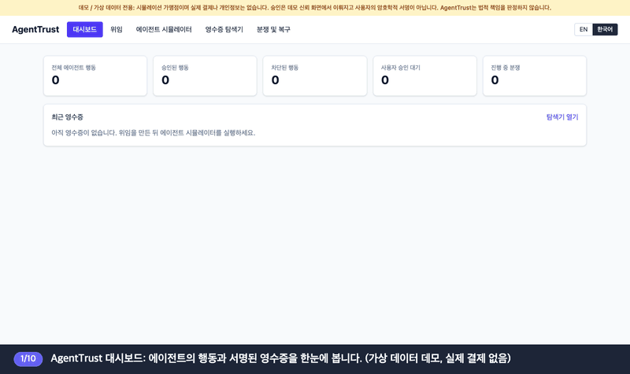
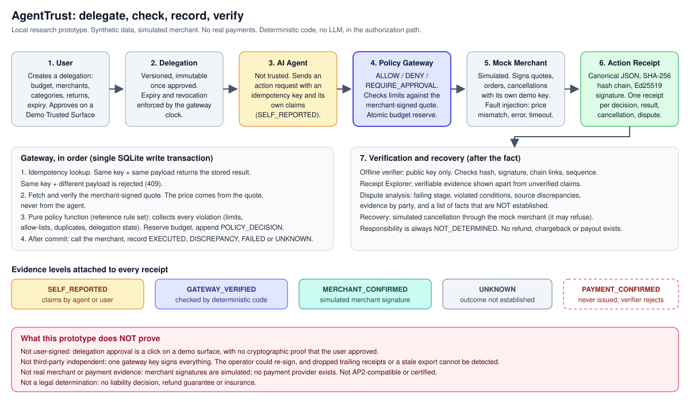
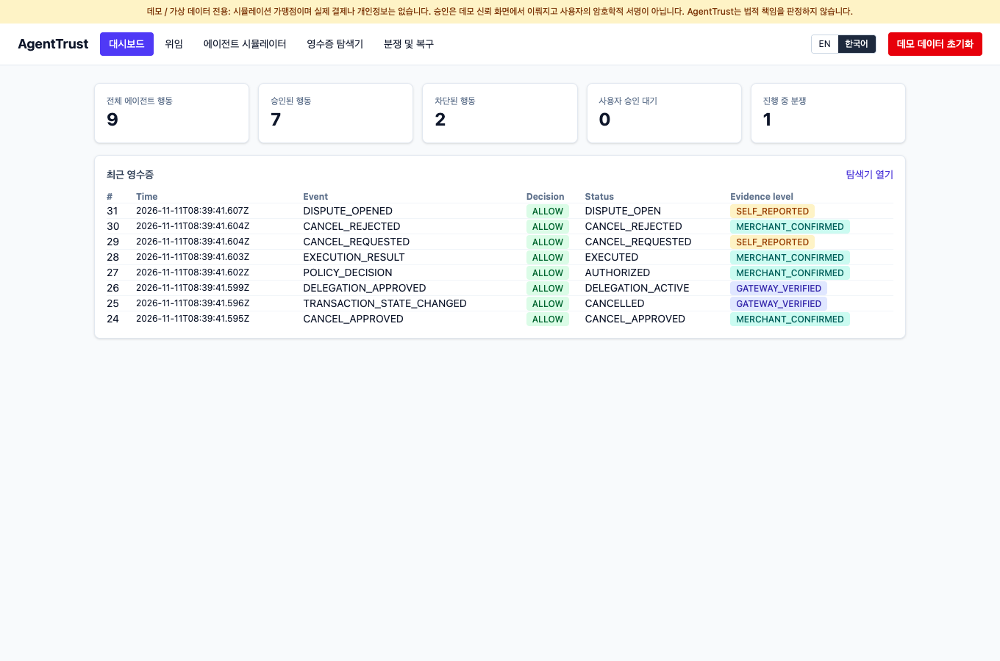
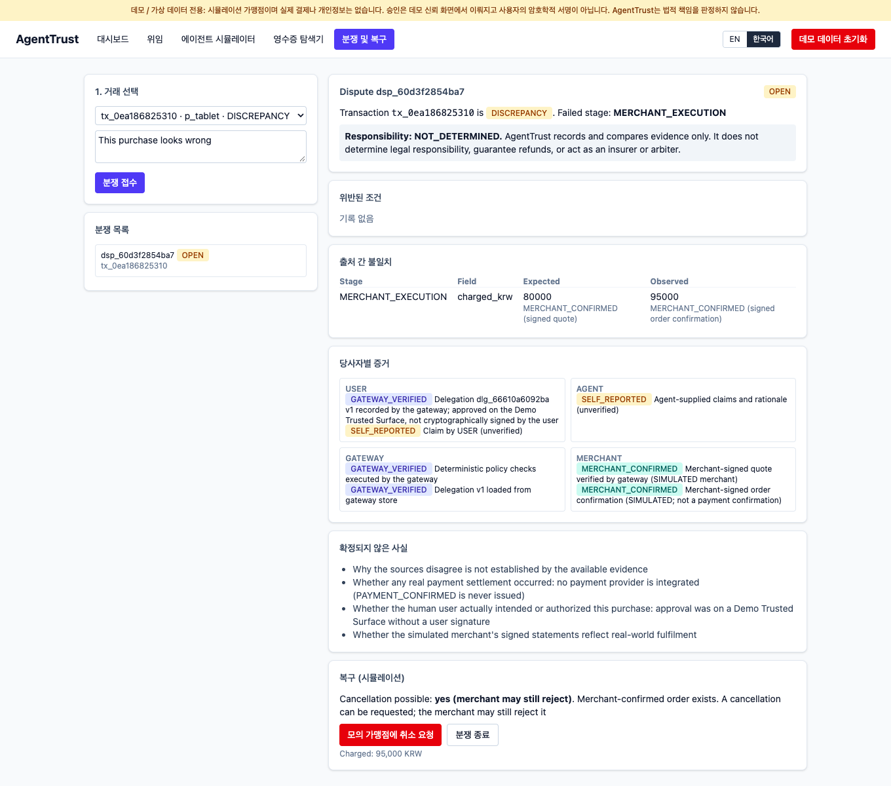
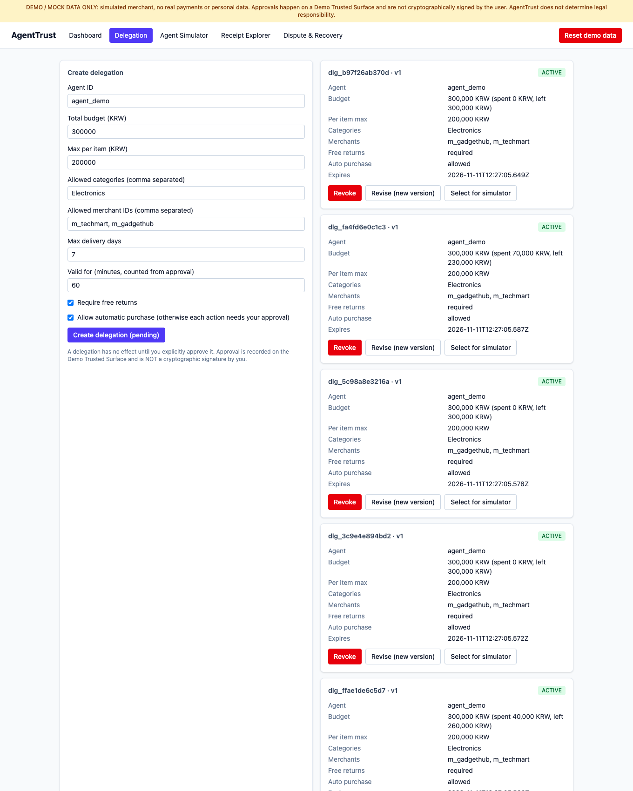
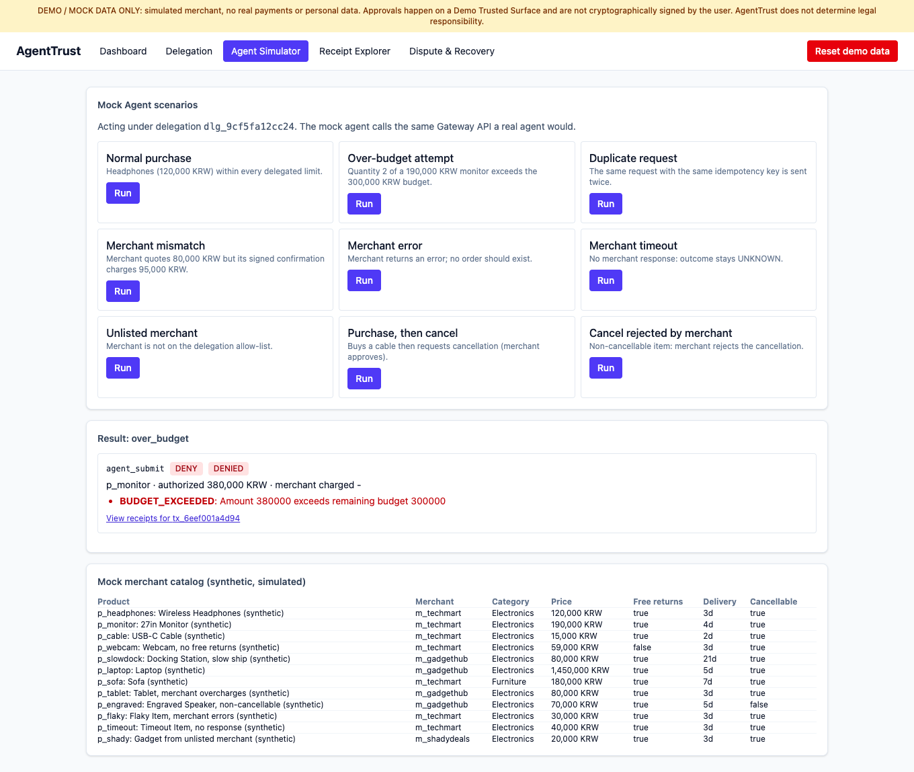

# AgentTrust

[English](README.md) · **한국어**

**나를 대신해 움직이는 AI 에이전트를 위한 독립 신뢰 계층.**
에이전트의 모든 행동을 사용자가 허용한 범위와 대조하고, 누구나 오프라인으로 다시 검증할 수 있는 서명 기록을 남기며, 문제가 생기면 무슨 일이 있었는지 추적합니다.


> 로컬 연구용 프로토타입입니다. 모든 데이터는 가상이며 가맹점은 시뮬레이션입니다. 실제 결제·카드·개인정보·보증·보험은 없습니다. 운영 용도가 아니며, 법률 자문이나 법적 책임 판정을 하지 않습니다.

## AgentTrust는 무엇인가요?

AI 에이전트가 대신 구매하거나 예약하면, 사용자는 에이전트가 스스로 말하는 내용을 믿을 수밖에 없습니다. AgentTrust는 이 의존을 없앱니다. **에이전트와 가맹점 사이**에 놓여 네 가지를 합니다.

1. **위임**: 사용자가 한도(예산, 가맹점, 카테고리, 만료)를 정하고 직접 승인합니다.
2. **검사**: LLM 없는 결정론적 게이트웨이가 모든 행동을 허용·거부하거나 사용자 승인을 요청합니다. 에이전트의 주장이 아니라 가맹점이 서명한 가격을 기준으로 합니다.
3. **기록**: 모든 결정과 결과가 해시 체인으로 이어진 Ed25519 서명 영수증이 되고, 증거 강도가 함께 표시됩니다.
4. **검증과 복구**: 공개키만 있으면 누구나 영수증을 오프라인으로 다시 확인합니다. 분쟁 화면은 당사자별 증거를 비교하고, *확정되지 않은* 사실을 나열하며, 모의 취소를 수행합니다.

| 대상 | 얻는 것 |
|---|---|
| **사용자** | 매 단계 승인 없이 위임하고, 에이전트가 왜 그렇게 했는지 읽을 수 있는 기록과 실수를 되돌릴 경로를 얻습니다. |
| **에이전트 제공자** | 프롬프트·모델·워크플로를 노출하지 않고, 에이전트가 사용자 한도 안에서 움직였음을 증명합니다. |
| **가맹점** | 정상 구매와 무단 구매를 구분하고, 분쟁 시 검증 가능한 증거를 갖습니다. |

`사용자 → 위임 → AI 에이전트 → 정책 게이트웨이 → (모의) 가맹점 → 행동 영수증 → 검증 및 복구`

## 데모 영상 (한국어 자막)



[전체 영상 (MP4, 1분 41초)](docs/demo-ko.mp4) · 자막이 순서대로 설명합니다: 위임 생성·승인 → 에이전트 시나리오 실행(정상, 예산 초과, 가맹점 금액 불일치) → 영수증 검증 → 분쟁 접수와 모의 취소 요청.

## 아키텍처



에이전트는 신뢰하지 않습니다. 게이트웨이의 결정론적 검사와 서명된 진술만 증거로 인정하고, 에이전트나 사용자가 *말한* 내용은 `SELF_REPORTED`로 남습니다. (다이어그램 글자는 영어입니다.)

## 화면

헤더의 **EN / 한국어** 버튼으로 UI 언어를 바꿀 수 있습니다. 메뉴, 제목, 주요 버튼, 핵심 안내만 번역하며 코드·증거 등급·영수증 데이터·API 메시지는 의도적으로 영어로 둡니다.

| 대시보드 (한국어) | 분쟁 및 복구 (한국어) |
|---|---|
|  |  |
| 승인·차단·대기 건수와 증거 등급이 붙은 최근 영수증. | 당사자별 증거, 출처 간 불일치(견적 80,000원 vs 청구 95,000원), 확정되지 않은 사실, 모의 취소. 책임 판단은 항상 `NOT_DETERMINED`. |

| 위임 (영어 화면) | 에이전트 시뮬레이터 (영어 화면) |
|---|---|
|  |  |
| 생성, 승인, 개정, 철회. 승인은 *데모 신뢰 화면*의 클릭이며 사용자 서명이 아닙니다. | 모의 에이전트가 실제 에이전트와 같은 API로 9개 시나리오를 실행합니다. |

## 기능

| 구성 요소 | 하는 일 |
|---|---|
| **위임 관리자** | 생성 → 승인의 명시적 흐름, 승인 후 버전 고정(불변), 만료·철회 강제. |
| **정책 게이트웨이** | 결정론적 코드로 `ALLOW` / `DENY` / `REQUIRE_APPROVAL` 반환. 가격은 가맹점이 서명한 견적에서 가져옵니다. 예산 예약·멱등성·영수증 추가는 원자적입니다(SQLite `BEGIN IMMEDIATE`). |
| **행동 영수증** | Canonical JSON, SHA-256 해시 체인, Ed25519 서명, 타임라인/JSON 보기. |
| **증거 등급** | `SELF_REPORTED`, `GATEWAY_VERIFIED`, `MERCHANT_CONFIRMED`(시뮬레이션), `UNKNOWN`. `PAYMENT_CONFIRMED`는 발급되지 않습니다. |
| **오프라인 검증기** | `verifier/agenttrust_verify.py`가 공개키만으로 해시·서명·체인을 검증합니다. |
| **복구 및 분쟁** | 당사자별 증거, 실패 단계, 미확정 사실, 모의 취소(모의 가맹점이 거절할 수 있음). 환불·차지백·지급 기능은 없습니다. |

**기술 스택**: Python · FastAPI · Pydantic · SQLAlchemy · SQLite · React · TypeScript · Vite · Tailwind · pytest · vitest · Docker Compose · GitHub Actions

## 검증

백엔드 67개(pytest), UI 5개(vitest) 테스트가 있습니다. 공격 시나리오는 [`backend/tests/test_adversarial.py`](backend/tests/test_adversarial.py)에 있습니다.

| 시나리오 | 결과 | 상태 |
|---|---|---|
| 영수증 수정(해시만 / 해시 재계산) | `HASH_MISMATCH` / `BAD_SIGNATURE` | 테스트됨 |
| 영수증 삭제·순서 변경·중복·서명 이식 | 체인/순번/서명 실패 | 테스트됨 |
| 증거 등급 부풀리기 | 거부 | 테스트됨 |
| 멱등성 키 재전송 또는 다른 페이로드로 재사용 | 한 번만 실행 / `409` | 테스트됨 |
| 승인·취소 재전송 | 이중 실행 없음 | 테스트됨 |
| 한 예산에 대한 동시 요청 | 예산 초과 없음 | 테스트됨 |
| 검증기에 악의적 입력 | 크래시 없이 문제 보고 | 테스트됨 |
| **최신 영수증 삭제 / 과거 정상 export 재제시** | **탐지 불가** (`test_known_limit_*`) | **미해결** |

## 실행 방법

요구 사항: Python 3.11+, Node 20+ (또는 Docker).

```bash
# 백엔드
cd backend && python3 -m venv .venv && .venv/bin/pip install -r requirements-dev.txt
AGENTTRUST_ALLOW_DEMO_RESET=true .venv/bin/python -m uvicorn app.main:default_app --factory --host 127.0.0.1 --port 8000
```
```bash
# 프론트엔드 (두 번째 터미널)
cd frontend && npm ci && npm run dev    # http://localhost:5173
```
```bash
# 또는 Docker로 한 번에
docker compose up --build
```

테스트: `cd backend && .venv/bin/python -m pytest -q` · `cd frontend && npm test`. API 문서: `http://127.0.0.1:8000/docs`, [API.md](API.md). 데모 안내: [DEMO.md](DEMO.md).

커밋된 샘플의 오프라인 검증:
```bash
python verifier/agenttrust_verify.py samples/sample_export.json \
  --public-key samples/gateway_public_key.hex --merchant-public-key samples/mock_merchant_public_key.hex
```

## 한계와 트레이드오프

- 위임 승인은 **데모 신뢰 화면**의 클릭일 뿐이며, **사용자가 서명했다는 암호학적 증거가 없습니다**.
- 단일 서버 서명과 해시 체인은 키가 없는 사람의 *변조*는 탐지하지만, 완전성(마지막 영수증 삭제), 서명자의 정직성, 제3자 독립성은 증명하지 못합니다.
- "독립적으로 감사 가능"과 "독립적으로 보증됨"은 다릅니다. 누구나 공개키로 재검증할 수 있지만 키는 같은 운영자가 갖고 있고, 어떤 제3자도 보증하지 않았습니다.
- 모의 가맹점 서명은 **시뮬레이션 증거**이며 실제 가맹점 증명이 아닙니다. 결제 제공자도 없습니다.
- 인증·속도 제한·테넌트 격리가 없으므로 localhost에서만 실행하세요([SECURITY.md](SECURITY.md)).
- Docker Compose와 GitHub Actions 워크플로는 포함돼 있으나 마지막 검증에서 실행하지 않았습니다.

## AP2와의 관계

Google의 [Agent Payments Protocol(AP2)](https://github.com/google-agentic-commerce/AP2)은 신뢰 화면에서의 사용자 승인 *mandate*와 서명된 영수증을 다룹니다. AgentTrust는 그 *개념*만 참고하며, **AP2 사양을 구현하지 않았고 AP2와 호환되거나 인증받지 않았으며 Google 및 AP2 프로젝트와 무관합니다**. AP2 매핑은 향후 과제입니다([ROADMAP.md](ROADMAP.md)).

## 공개 참고용 버전

이 저장소는 포트폴리오용 공개 버전으로, 의도적으로 **단순화한 참고용 규칙과 분쟁 분석**을 담은 완전한 동작 데모입니다. 더 완전한 구현은 공개하지 않습니다. 이 버전에서는 위임의 `require_free_returns`, `max_delivery_days`를 저장만 하고 **적용하지 않으며**, 에이전트가 보낸 `claimed` 값은 서명된 견적과 대조하지 않고 `SELF_REPORTED`로 기록만 하고, 분쟁 분석은 실제 운영용보다 단순합니다.

## 구조

```
backend/   FastAPI 앱, SQLAlchemy 모델, 테스트, 샘플 생성기
frontend/  React + Vite + Tailwind UI (EN/KO), vitest 테스트
verifier/  독립 오프라인 검증기 (`cryptography`만 필요)
samples/   가상 서명 영수증 + 공개키
docs/      아키텍처 다이어그램, 데모 영상, UI 스크린샷
```

## 저작권 및 이용 안내

저작권 © 2026 Sihun Wang. 모든 권리 보유.

이 프로젝트는 열람 및 포트폴리오 시연 목적으로 공개됩니다. 원본 소스 코드, 문서, 디자인 및 프로젝트 고유 자산에 대한 모든 권리는 저작자에게 있습니다. 관련 법령 또는 GitHub 이용약관이 허용하는 범위를 제외하고, 저작자의 사전 서면 허락 없이 원본 자료를 복제, 수정, 재배포하거나 상업적으로 이용할 수 없습니다. 제3자 라이브러리, 의존성 및 외부에서 가져온 자료는 각각의 라이선스와 소유권에 따릅니다([LICENSE_NOTICES.md](LICENSE_NOTICES.md) 참조). 라이선스, 협업 또는 상업적 문의는 저장소 소유자에게 연락해 주십시오.
