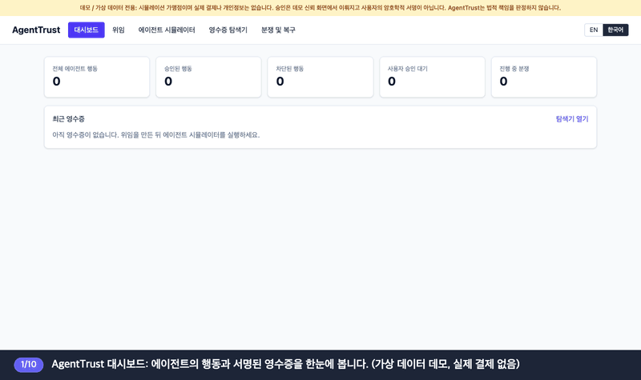
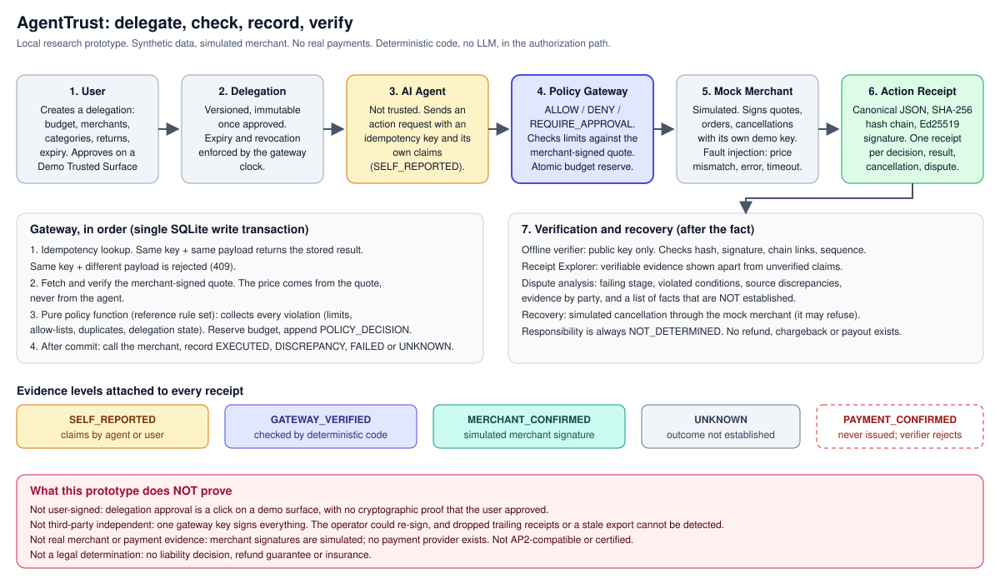
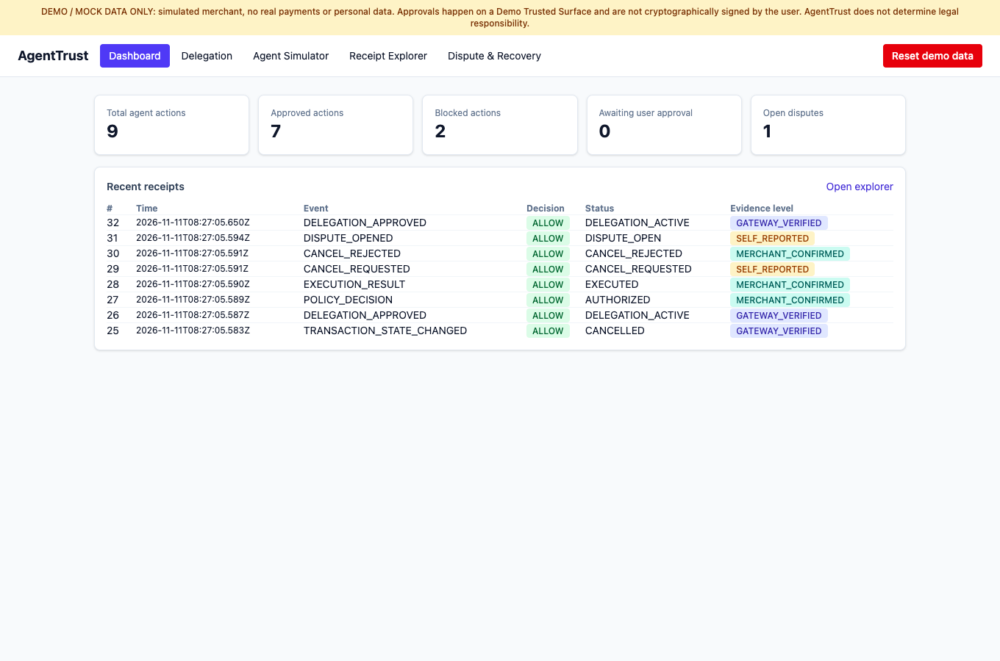
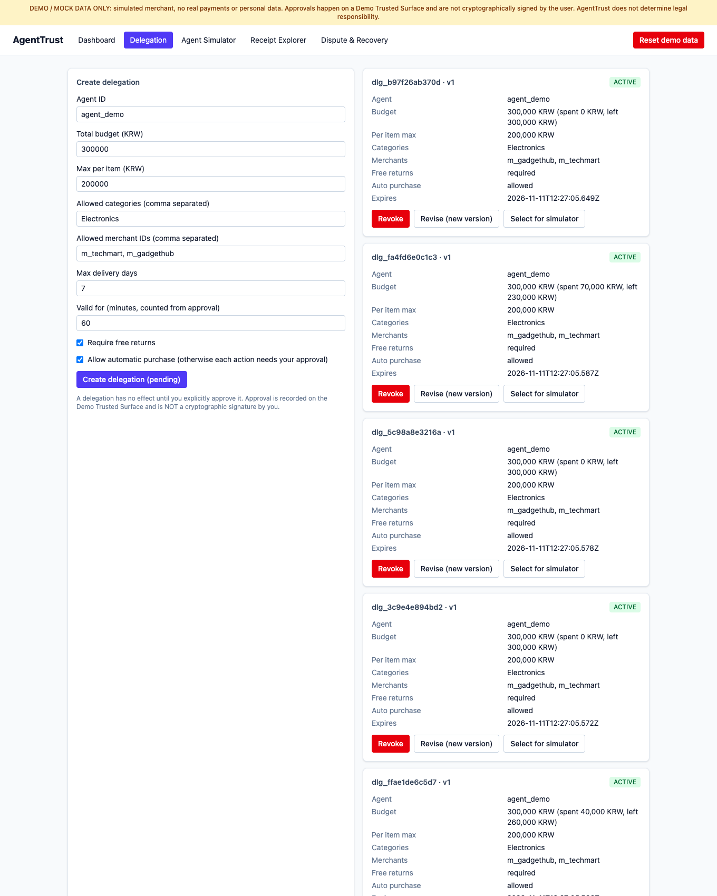
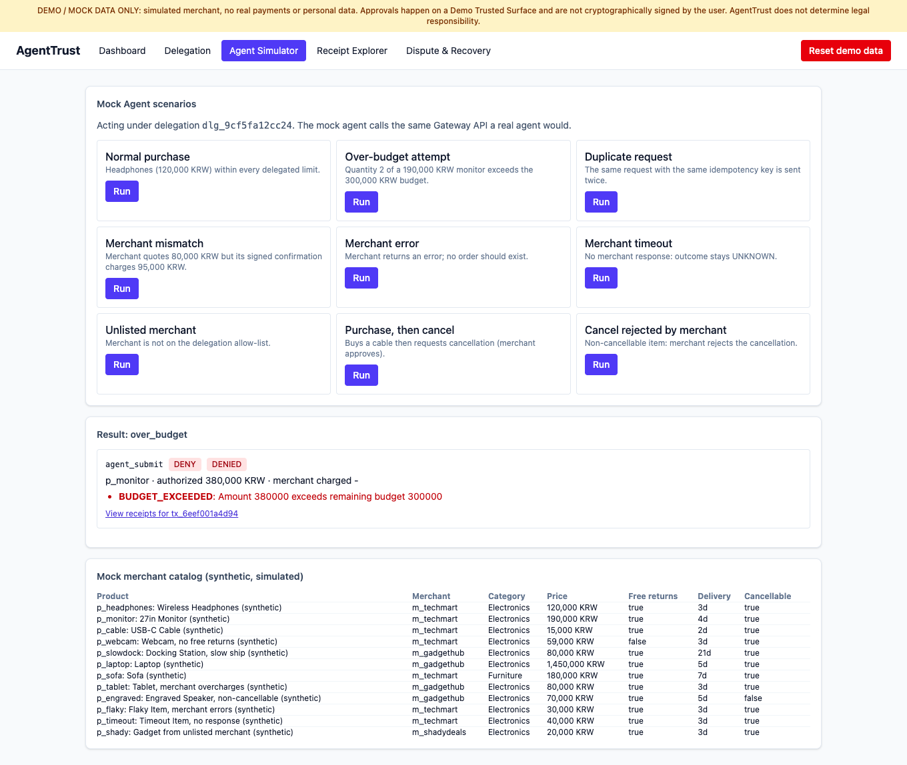
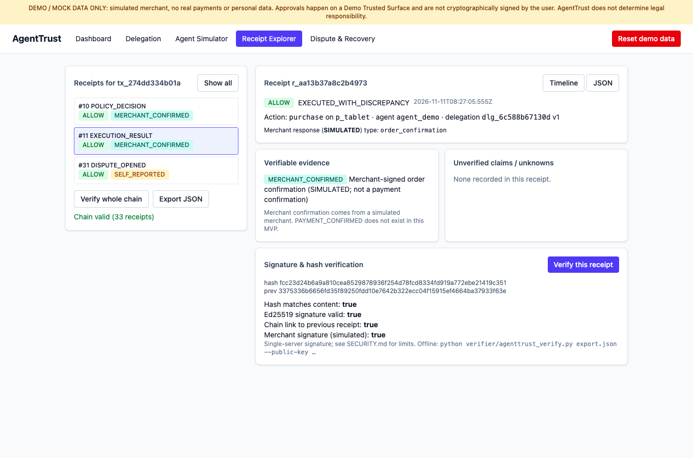
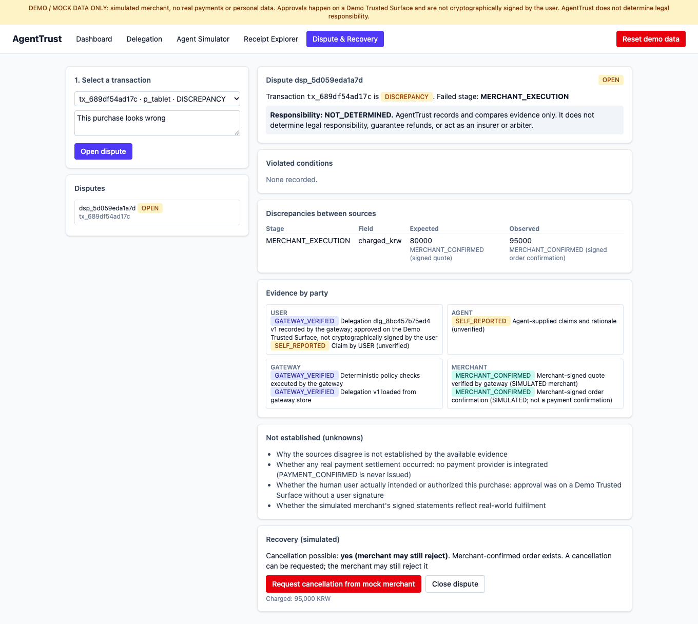

# AgentTrust

**English** · [한국어](README.ko.md)

**An independent trust layer for AI agents that act on your behalf.**
Check every agent action against what you allowed, keep a signed record anyone can re-verify offline, and trace what happened when something goes wrong.


> Local research prototype. All data is synthetic and the merchant is simulated. No real payments, cards, personal data, guarantees or insurance. Not for production, not legal advice, and not a legal-responsibility decision-maker.

## What is AgentTrust?

When an AI agent buys or books something for you, you have to trust the agent's own account of what it did. AgentTrust removes that dependence. It sits **between the agent and the merchant** and does four things:

1. **Delegate**: you set the limits (budget, merchants, categories, expiry) and approve them explicitly.
2. **Check**: a deterministic gateway (no LLM) allows, denies or asks for your approval on every action, using the merchant-signed price rather than the agent's claim.
3. **Record**: every decision and result becomes a hash-chained, Ed25519-signed receipt, labelled with how strong its evidence is.
4. **Verify and recover**: anyone with the public key can re-check the receipts offline; a dispute view compares evidence by party, lists what is *not* established, and simulates a cancellation.

| Who | What they get |
|---|---|
| **User** | Delegation without approving every step, a readable record of why the agent acted, a path to undo mistakes. |
| **Agent provider** | Proof the agent stayed inside the user's limits, without exposing prompts, models or workflows. |
| **Merchant** | A way to tell legitimate purchases from unauthorized ones, with verifiable evidence in a dispute. |

`User → Delegation → AI Agent → Policy Gateway → (Mock) Merchant → Action Receipt → Verification & Recovery`

## Watch the demo (Korean, with captions)



[Full video (MP4, 1:41)](docs/demo-ko.mp4) · The captions walk through: create and approve a delegation → run agent scenarios (allowed, over budget, merchant mismatch) → verify receipts → open a dispute and request a simulated cancellation.

## Architecture



The agent is untrusted. Only the gateway's deterministic checks and signed statements count as evidence; whatever the agent or user merely *says* stays labelled `SELF_REPORTED`.

## Screens

The UI has an **EN / 한국어** switch in the header. Navigation, titles, main buttons and key notices are translated; codes, evidence levels, receipt data and API messages stay in English on purpose.

| Dashboard | Delegation |
|---|---|
|  |  |
| Counts of approved, blocked and pending actions, and the latest receipts with evidence level. | Create, approve, revise, revoke. Approval is a click on a *Demo Trusted Surface*, not a user signature. |
| **Agent Simulator** | **Receipt Explorer** |
|  |  |
| A mock agent runs 9 scenarios through the same API a real agent would use. | Verifiable evidence shown apart from unverified claims; hash, signature and chain checks. |

**Dispute & Recovery**: evidence by party, source discrepancies (quoted 80,000 KRW vs charged 95,000 KRW), facts that are *not* established, and a simulated cancellation. Responsibility is always `NOT_DETERMINED`.



## Capabilities

| Component | What it does |
|---|---|
| **Delegation Manager** | Explicit create → approve; versioned and immutable once approved; expiry and revocation enforced. |
| **Policy Gateway** | Deterministic code returning `ALLOW` / `DENY` / `REQUIRE_APPROVAL`. Prices come from a merchant-signed quote. Budget reservation, idempotency and receipt append are atomic (SQLite `BEGIN IMMEDIATE`). |
| **Action Receipts** | Canonical JSON, SHA-256 hash chain, Ed25519 signature; timeline or JSON view. |
| **Evidence levels** | `SELF_REPORTED`, `GATEWAY_VERIFIED`, `MERCHANT_CONFIRMED` (simulated), `UNKNOWN`. `PAYMENT_CONFIRMED` is never issued. |
| **Offline verifier** | `verifier/agenttrust_verify.py` checks hashes, signatures and chain with only a public key. |
| **Recovery & disputes** | Per-party evidence, failing stage, unknown facts, simulated cancellation (the mock merchant may refuse). No refund, chargeback or payout exists. |

**Stack**: Python · FastAPI · Pydantic · SQLAlchemy · SQLite · React · TypeScript · Vite · Tailwind · pytest · vitest · Docker Compose · GitHub Actions

## Verification

67 backend tests (pytest) and 5 UI tests (vitest). Adversarial cases are in [`backend/tests/test_adversarial.py`](backend/tests/test_adversarial.py).

| Scenario | Result | Status |
|---|---|---|
| Edited receipt (hash only / hash recomputed) | `HASH_MISMATCH` / `BAD_SIGNATURE` | tested |
| Receipt deleted, reordered, duplicated, signature transplanted | chain / sequence / signature failure | tested |
| Evidence level inflated | rejected | tested |
| Idempotency key replayed or reused with another payload | executed once / `409` | tested |
| Replayed approval or cancellation | no second execution | tested |
| Concurrent requests on one budget | budget never exceeded | tested |
| Hostile input to the verifier | problems reported, no crash | tested |
| **Newest receipts dropped; older genuine export replayed** | **not detected** (`test_known_limit_*`) | **open** |

## Quick start

Requirements: Python 3.11+, Node 20+ (or Docker).

```bash
# backend
cd backend && python3 -m venv .venv && .venv/bin/pip install -r requirements-dev.txt
AGENTTRUST_ALLOW_DEMO_RESET=true .venv/bin/python -m uvicorn app.main:default_app --factory --host 127.0.0.1 --port 8000
```
```bash
# frontend (second terminal)
cd frontend && npm ci && npm run dev    # http://localhost:5173
```
```bash
# or everything with Docker
docker compose up --build
```

Tests: `cd backend && .venv/bin/python -m pytest -q` · `cd frontend && npm test`. API docs: `http://127.0.0.1:8000/docs`, [API.md](API.md). Walkthrough: [DEMO.md](DEMO.md).

Offline verification of the committed sample:
```bash
python verifier/agenttrust_verify.py samples/sample_export.json \
  --public-key samples/gateway_public_key.hex --merchant-public-key samples/mock_merchant_public_key.hex
```

## Limits and trade-offs

- Delegation approval is a click on a **Demo Trusted Surface**: there is **no cryptographic proof that the user signed it**.
- One server signature plus a hash chain detects *alteration* by anyone without the key, but cannot prove completeness (trailing receipts can be dropped), signer honesty, or third-party independence.
- "Independently auditable" is not "independently assured": anyone can re-check receipts with the public key, but the same operator holds the key. No third party has attested anything.
- Mock Merchant signatures are **simulation evidence**, not real merchant attestations. No payment provider exists.
- No authentication, rate limiting or tenant isolation: bind to localhost only ([SECURITY.md](SECURITY.md)).
- Docker Compose and the GitHub Actions workflow are included but were not exercised in the last verification pass.

## Relationship to AP2

Google's [Agent Payments Protocol (AP2)](https://github.com/google-agentic-commerce/AP2) describes user-approved *mandates* on a trusted surface and signed receipts. AgentTrust borrows that *concept* but **implements none of the AP2 specification and is not AP2-compatible, certified, or affiliated with Google or the AP2 project**. Mapping to AP2 is future work ([ROADMAP.md](ROADMAP.md)).

## Public reference edition

This is the public portfolio edition: a complete working demo with a deliberately **simplified reference rule set and dispute analysis**. A fuller implementation is not published. Here, delegations store `require_free_returns` and `max_delivery_days` but **do not enforce** them, agent-supplied `claimed` values are recorded as `SELF_REPORTED` without cross-checking against the signed quote, and dispute analysis is simpler than a production analysis would be.

## Layout

```
backend/   FastAPI app, SQLAlchemy models, tests, sample generator
frontend/  React + Vite + Tailwind UI (EN/KO), vitest tests
verifier/  standalone offline verifier (depends only on `cryptography`)
samples/   synthetic signed receipts + public keys
docs/      architecture diagram, demo video, UI screenshots
```

## Copyright & Usage

Copyright © 2026 Sihun Wang. All Rights Reserved.

This project is publicly available for viewing and portfolio demonstration purposes. All rights to the original source code, documentation, designs, and project-specific assets are reserved by the author. No permission is granted to reproduce, modify, redistribute, or commercially use the original materials without prior written authorization, except as permitted by applicable law or GitHub's Terms of Service. Third-party libraries, dependencies, and other externally sourced materials remain subject to their respective licenses and ownership rights (see [LICENSE_NOTICES.md](LICENSE_NOTICES.md)). For licensing, collaboration, or commercial inquiries, please contact the repository owner.
